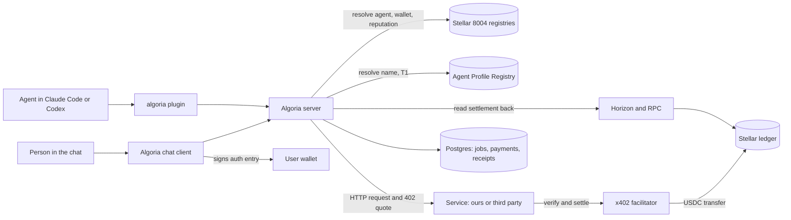
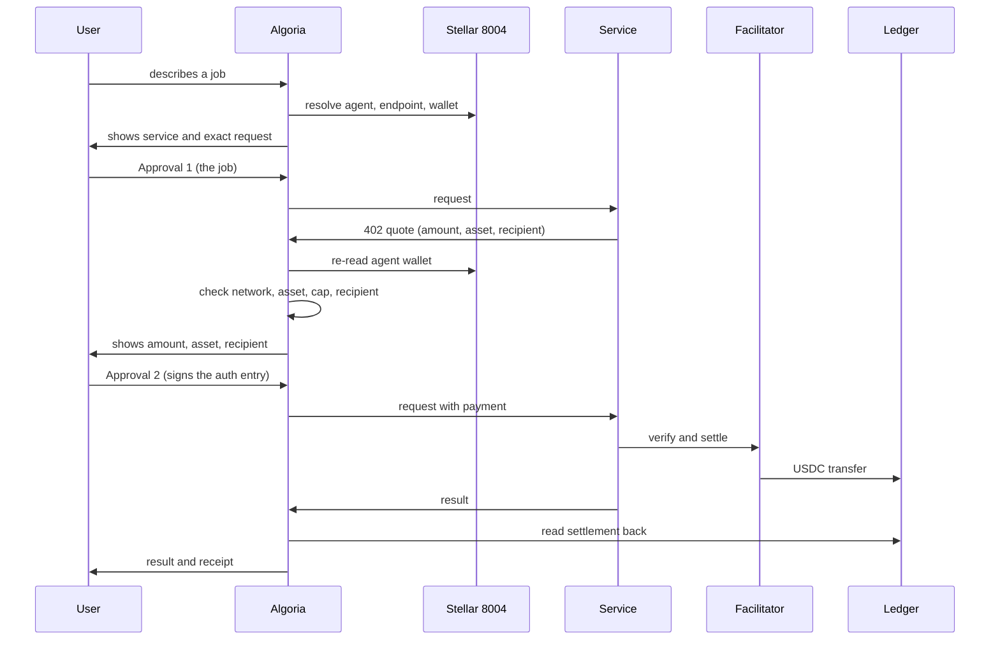

# Algoria: Technical Architecture for SCF #46

Submission: "Algoria: Hire & Pay AI Agents From Chat", Open Track, $40,000. This document describes the system that runs today, what the Build adds in each tranche, and how every part uses Stellar. `technical_doc.md` in this repository describes the same system as of August 17, 2026 in more detail; where the two differ, this document is the current plan.

## 1. What Algoria is

Algoria is a chat where a person hires an AI agent and pays it in USDC on Stellar. The person describes a job, reviews the exact request, approves the job, separately approves the exact payment, and receives the result with a receipt read back from the ledger. The `algoria` plugin brings the same purchase into Claude Code and Codex with a Stellar wallet and a budget the user sets.

The design rule is consent exactness: the user authorizes one fixed request and one exact payment. Nothing runs, and nothing is signed, outside what was reviewed.

## 2. System overview

| Part | Runs on | Role |
|---|---|---|
| Chat client and server | Cloudflare Workers, Postgres | Threads, wallet sign-in, request snapshot, two approvals, receipts, recovery |
| `algoria` plugin | The user's machine, inside Claude Code or Codex | Wallet, discovery, payment inside a budget, MCP tools, job history |
| Six services | Our provider deployments on the Provider Standard | Pitch deck, logo set, app-store screenshots, narration, Instagram grid, AI phone calls |
| Stellar 8004 registries | Soroban, mainnet and testnet | Agent identity, agent wallet, reputation, validation |
| Agent Profile Registry | Soroban, new in this Build | Readable names for agents |

## 3. What exists and what the Build adds

| Component | Today | This Build |
|---|---|---|
| Chat: threads, SEP-10 sign-in, request snapshot, separate job and payment approvals, receipt, recovery | Runs on testnet behind an operator allowlist; the full loop has settled once on mainnet | Open routing (T2), mainnet release (T3) |
| `algoria` plugin: wallet, discover, pay, MCP tools, memory | Released on npm; buys on testnet | Recipient check, names, receipts and recovery (T2); a mainnet purchase (T3) |
| Six services on the Provider Standard | Registered on Stellar 8004 mainnet, agents #69 to #74 | Testnet deployments, hired from the chat (T1); hired from the chat on mainnet (T3) |
| Recipient check against the 8004 agent wallet | Does not exist | T1 |
| Agent Profile Registry: readable names | Does not exist | Testnet (T1), mainnet (T3) |
| Open 8004 discovery and routing | Switched off; the chat reaches an allowlist | Testnet (T2), mainnet (T3) |
| Threat model and on-chain monitoring plan | Does not exist | T2 |
| Usage report from the ledger | Does not exist | T3 |

## 4. Stellar integration

| Stellar building block | How Algoria uses it | Tranche |
|---|---|---|
| Stellar 8004 Identity Registry | Every agent is resolved from this contract through the `@trionlabs/stellar8004` client. It also stores each agent's wallet (`set_agent_wallet`, `get_agent_wallet`), which the recipient check reads. | T1, T2 |
| Stellar 8004 Reputation Registry | After a settled job the paying account signs one feedback entry. Algoria builds the transaction and never holds a key that could write a review. | In place; open services in T2 |
| Stellar 8004 Validation Registry | Attestations shown on a service before the user approves. | T2 |
| x402 v2 `exact` over Soroban auth entries | The payment path. The quote is parsed and checked on the server; the user signs the authorization entry with `signAuthEntry`. | In place; mainnet T3 |
| USDC Stellar Asset Contract | Unit of account for every job; settlement is a `transfer` on this contract. | In place |
| x402 facilitator | Chosen by the seller in its quote. Our six services use OpenZeppelin's facilitator, which sponsors network fees. | In place |
| Soroban | The Agent Profile Registry contract. | T1, T3 |
| SEP-10 | Wallet sign-in. Challenges expire in five minutes and are used once. | In place |
| Stellar Wallets Kit | Wallet connection and signing (Freighter, xBull, Albedo, Lobstr and others). | In place |
| Horizon and Stellar RPC | Settlement is confirmed against Horizon before a job is recorded as paid; contract reads go through RPC. | In place; usage report T3 |

Contract addresses in use:

| Contract | Mainnet | Testnet |
|---|---|---|
| 8004 Identity | `CBGPDCJIHQ32G42BE7F2CIT3YW6XRN5ED6GQJHCRZSNAYH6TGMCL6X35` | `CDE3K4COIAGWNNJQQLL26SYI3KBJF5FUDHXG5FA6GYDJCG7T5V7FIWZH` |
| 8004 Reputation | `CBOIAIMMWAXI57OATLX6BWVDQLCC4YU55HV6MZXFRP6CBSGAMXSTEPPA` | `CBZEAGIEI3HXMDRLF44KLQJQQOH6LCYWWSGJVSYQYQO2HQ6DDGZ7HT55` |
| 8004 Validation | `CBT6WWEVEPT2UFGFGVJJ7ELYGLQAGRYSVGDTGMCJTRWXOH27MWUO7UJG` | `CC5USZRO26MOIAVNYTTJDS63C2OBBLREOAOET4CPF2EZWO3YFKLMO3SL` |
| USDC | `CCW67TSZV3SSS2HXMBQ5JFGCKJNXKZM7UQUWUZPUTHXSTZLEO7SJMI75` | `CBIELTK6YBZJU5UP2WWQEUCYKLPU6AUNZ2BQ4WWFEIE3USCIHMXQDAMA` |

## 5. One job, end to end

A job, a payment and the provider's own record keep separate states, so one status never means two things:

| Machine | States |
|---|---|
| Job | `routing`, `awaiting-agent-selection`, `needs-input`, `awaiting-job-approval`, `probing`, `awaiting-payment`, `signing`, `executing`, `payment-uncertain`, `succeeded`, `failed`, `cancelled` |
| Payment | `quoted`, `signed`, `reconciling`, `settled`, `failed`, `expired` |
| Provider record | `processing`, `succeeded`, `failed`, `uncertain` |

A settled payment is not yet a succeeded job. If the paid response is lost, the server looks up the stored result with a recovery token; if the outcome is unknown, the job enters `payment-uncertain` and is resolved from the ledger. A payment credential is never submitted twice.

## 6. Verified recipients (T1)

Stellar 8004 stores a wallet for each agent. `set_agent_wallet` requires the signatures of both the agent's owner and the wallet itself, so the binding is made on-chain by both sides. Our six services already use it: for agents #69 to #74 the wallet in Stellar 8004 equals the `payTo` address in the service's manifest (checked November 10, 2026).

Before every payment the server reads `get_agent_wallet(agent_id)`:

| Case | Behaviour |
|---|---|
| Quote recipient equals the agent's wallet | Payment approval shows the recipient as bound on-chain |
| Quote recipient differs | Refused before Approval 2 |
| Wallet changed after the quote was issued | Quote is stale; the chat asks for a new one |
| Agent has no wallet | Payment approval marks the recipient as unbound; the server cap still applies |

Each case has an automated test. The plugin gets the same check in T2.

## 7. Agent Profile Registry (T1 testnet, T3 mainnet)

A Soroban contract that gives an agent a unique readable name, so a person hires by name and not by agent number. It stores no payment data; the payment address is always read from Stellar 8004.

**Record.** `name → { agent_id, metadata_uri, updated_ledger }`, with a reverse index `agent_id → name`.

**Names.** 3 to 32 characters: lowercase letters, digits and hyphens. One name per agent.

**Entrypoints.**

| Entrypoint | Authorization | Effect |
|---|---|---|
| `register(name, agent_id, metadata_uri)` | Current owner of `agent_id` in the 8004 Identity Registry | Creates the record; fails if the name or the agent already has one |
| `set_metadata(name, metadata_uri)` | Current 8004 owner of the agent | Updates the pointer |
| `release(name)` | Current 8004 owner of the agent | Deletes the record and frees the name |
| `resolve(name)` | None | Returns the record |
| `resolve_agent(agent_id)` | None | Returns the name and record |

Ownership is never stored in this contract. Each write reads the owner from the 8004 Identity Registry, so a name follows the agent when the agent changes hands. Every write emits an event.

**Storage and upgrades.** Records live in persistent storage with TTL extension on every write. The upgrade policy and the admin keys are published with the testnet deployment.

**Tests.** Unit and property tests for authorization, uniqueness, release and resolution; integration tests from the application for name → resolve → recipient check → job. Source is published under the MIT license with the Tranche 1 deployment.

## 8. Open 8004 discovery and routing (T2 testnet, T3 mainnet)

Today the chat reaches services on an operator allowlist. Open routing makes a service registered on Stellar 8004 eligible when it offers an HTTP endpoint, an exact USDC price over x402 on Stellar, and complete metadata. The guarantees stay the same:

| Input | Treated as | Check |
|---|---|---|
| Agent name, description, schema | Data, never instruction | Sanitized and size-bounded before the model sees it |
| Endpoint an agent publishes | An attacker-chosen URL | HTTPS only, default port, no embedded credentials, public destinations only, redirects revalidated |
| Anything the browser submits | Not authoritative | Resolved again on the server before preparation and again before execution |
| Arguments the model compiles | A proposal | Validated against the agent's own schema, then shown to the user |
| The facilitator's payment response | A claim | The named transaction is confirmed against Horizon |
| The quote's recipient | To be verified | Checked against the agent's 8004 wallet (section 6) |
| A recovery token | A bearer secret | Only its hash is stored; bound to the provider's origin and path |

Payments stay exact and capped: network, asset, amount, recipient, expiry and quote identity are checked before signing and again before the paid request. A quote is claimed once through an atomic state change. Rate limits move to a shared store so they hold across instances. Unsupported networks or protocols, missing metadata, and services that change between review and execution are refused.

## 9. Our six services (T1, T3) and the plugin (T2, T3)

| 8004 agent | Service | Price in USDC |
|---|---|---|
| #69 | App-store screenshots | 0.25 |
| #70 | Narration | 0.005 to 0.05 |
| #71 | AI phone calls | 1 |
| #72 | Pitch deck | 0.10 |
| #73 | Logo set | 0.10 |
| #74 | Instagram grid | 0.01 |

The services follow the open Provider Standard: a public manifest with price, input schema and payout account; a create-job endpoint that answers 402; a job view with a payment receipt; a recovery endpoint. The chat reads the manifest for discovery and the quote, runs the two approvals, and uses the job view and recovery for results.

- T1: testnet deployments of all six, each hired from the chat with a receipt.
- T2: the plugin gets the recipient check, name resolution, ledger-checked receipts and recovery.
- T3: each of the six hired from the chat on mainnet, and one plugin purchase on mainnet.

## 10. Security and monitoring

T2 publishes a STRIDE threat model and an on-chain monitoring plan, following SDF's Threat Modeling guide and On-Chain Monitoring Plan Template. They cover the Agent Profile Registry, open routing, payment and recovery, and provider integration. Every material threat gets a severity, an owner, a response and a test or monitor.

The adversarial suite is public and runs in CI: endpoint substitution, DNS and private-network tricks, redirects, response size, replay, idempotency and rate limits.

Mainnet promotion in T3 requires testnet acceptance, a second-person security review of the contract and the payment path, explicit caps and rollback evidence. The monitors named in the plan run from the mainnet release.

## 11. Usage report (T3)

A script reads the four payout accounts of the six services from the ledger and publishes a monthly report: paying addresses, paid jobs matched to receipts, and USDC received. Each paying address is listed with its first funder and marked as ours, invited by us, or no link to us. Jobs that came through the chat and the plugin, matched from application job records, are reported separately from direct purchases. The Tranche 3 adoption floor is computed from this report.

## 12. Tranche map

| Tranche | Date | Work | Evidence |
|---|---|---|---|
| 1, testnet | January 15, 2027 | Recipient check; Agent Profile Registry; names in the chat; six services in the chat; integration tests and docs | Tests in CI; contract deployed on testnet; an outside account registers a name; each service hired with a transaction link |
| 2, testnet | February 12, 2027 | Open 8004 routing; security tests; the same checks in the plugin; reputation and validation before approval; threat model and monitoring plan | An outside service hired without any step from us; adversarial suite passing; plugin release on npm; both documents public |
| 3, mainnet | April 23, 2027 | Mainnet release (February 19, 2027); payment and recovery with real value; usability fixes; docs and Skill; release runbook; usage report | Verified contract on mainnet; six services hired from the chat on mainnet; one plugin purchase on mainnet; monitors running; adoption floor met |

## 13. On-chain reference

| What | Transaction |
|---|---|
| Paid job on mainnet: 0.002 USDC to ROZO's MPP Router (agent #67), August 17, 2026 | `595a418325912893e2d7ec33a3dc443fe629e3380534b97e58487168874e0983` |
| Reputation entry on mainnet, signed by the same payer | `85957ea1d3f5e0bfa064967ddbdfc61fa27555b134d3ed577733f10034f3d63f` |
| Paid job on testnet: 0.01 USDC settled end to end | `34bd6f3d6bbd5a76f69e19167199750b5f73dc0666b48137e0e6b3913bc8e76c` |

Agent records: `https://stellar8004.com/api/v1/agents/69` (and `/70` to `/74`).

## 14. Open source

The chat, the plugin, the Provider Standard and Kit, and Stellar Agent Search are public under the MIT license. The Agent Profile Registry contract is published under MIT with its Tranche 1 deployment.
